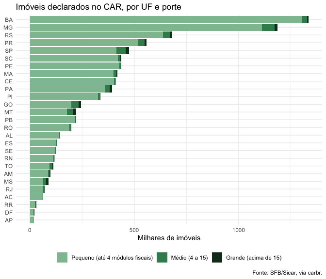
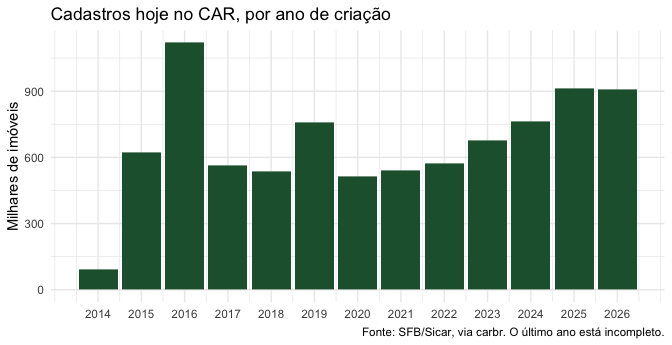
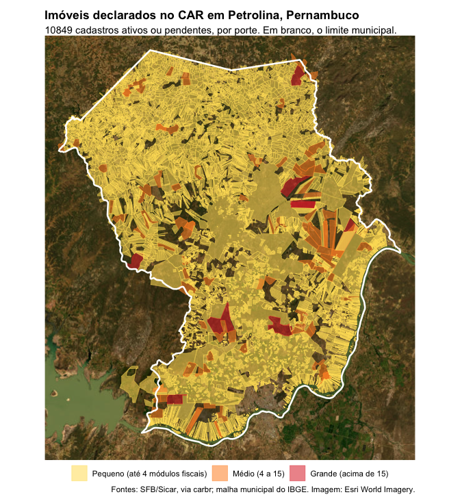

O **Cadastro Ambiental Rural (CAR)** é o registro público eletrônico dos
imóveis rurais do país, criado pelo Código Florestal (Lei nº 12.651/2012) e
mantido no Sicar pelo Serviço Florestal Brasileiro. O `carbr` lê uma
republicação dos dados públicos do cadastro em GeoParquet, com as 27 UFs e
cerca de 8,6 milhões de imóveis. Cada consulta transfere só os trechos do
arquivo de que precisa, sem baixar a base de um estado inteiro e sem passar
pelos servidores do Sicar.

| Função | Para quê |
|---|---|
| `car_catalog()` | O que está publicado |
| `car_dictionary()` | O que cada coluna significa |
| `car_summary()` | Totais pré-calculados, do estado ou do país |
| `car_municipalities()` | Resumo por município |
| `car_properties()` | Imóveis de uma UF, com filtros |
| `car_property()` | Um imóvel pelo código |
| `car_at()` | Imóveis que contêm um ponto |
| `car_tbl()` | Tabela preguiçosa para o `dplyr` |
| `car_cite()` | Como citar |


A leitura parcial é feita pelo DuckDB com a extensão oficial `httpfs`. Na
primeira consulta, em sessão interativa, o pacote pergunta se pode
instalá-la; em scripts e relatórios, rode `car_install_httpfs()` uma vez.

``` r
library(carbr)
library(dplyr)
library(ggplot2)
```

## O que está publicado

`car_catalog()` traz uma linha por UF, com o número de imóveis e os
indicadores de qualidade da carga. A versão é a data da última atualização
da publicação.


``` r
cat <- car_catalog()
cat
#> # A tibble: 27 × 6
#>   state properties municipalities invalid_geometries null_geometries
#>   <chr>      <int>          <int>              <int>           <int>
#> 1 AC         63349             22                 19               0
#> 2 AL        143973            102                 19               0
#> 3 AM         99056             62                 94               0
#> 4 AP         17834             16                  2               0
#> 5 BA       1334593            416                  2               0
#> 6 CE        410650            184                 56               0
#>   registered_in_other_state
#>                       <int>
#> 1                         0
#> 2                         5
#> 3                         0
#> 4                         0
#> 5                         1
#> 6                         3
#> # ℹ 21 more rows
attr(cat, "version")
#> [1] "2026-11-25"
sum(cat$properties)
#> [1] 8578061
```

O dicionário de dados diz o que é cada coluna e qual era o seu nome no Sicar.


``` r
car_dictionary() |> print(n = 22)
#> # A tibble: 22 × 3
#>    column             sicar_name        
#>    <chr>              <chr>             
#>  1 property_code      cod_imovel        
#>  2 status_code        status_imovel     
#>  3 status             <NA>              
#>  4 condition          condicao          
#>  5 property_type_code tipo_imovel       
#>  6 property_type      <NA>              
#>  7 created_at         dat_criacao       
#>  8 area_ha            area              
#>  9 fiscal_modules     m_fiscal          
#> 10 size_class         <NA>              
#> 11 state              uf                
#> 12 municipality       municipio         
#> 13 municipality_code  cod_municipio_ibge
#> 14 registration_state <NA>              
#> 15 lon                <NA>              
#> 16 lat                <NA>              
#> 17 geometry_valid     <NA>              
#> 18 xmin               <NA>              
#> 19 ymin               <NA>              
#> 20 xmax               <NA>              
#> 21 ymax               <NA>              
#> 22 geometry           geo_area_imovel   
#>    description                                                                  
#>    <chr>                                                                        
#>  1 Código do imóvel no CAR (UF-município IBGE-identificador).                   
#>  2 Situação do cadastro: AT ativo, PE pendente, SU suspenso, CA cancelado.      
#>  3 Situação do cadastro por extenso, derivada de status_code.                   
#>  4 Etapa da análise em que o cadastro está, como informada pelo Sicar.          
#>  5 IRU imóvel rural, AST assentamento, PCT povos e comunidades tradicionais.    
#>  6 Tipo do imóvel por extenso, derivado de property_type_code.                  
#>  7 Data e hora de criação do cadastro (UTC).                                    
#>  8 Área declarada do imóvel, em hectares.                                       
#>  9 Área em módulos fiscais do município.                                        
#> 10 small até 4 módulos fiscais, medium acima de 4 até 15, large acima de 15.    
#> 11 UF onde o imóvel está localizado.                                            
#> 12 Município onde o imóvel está localizado.                                     
#> 13 Código IBGE do município (7 dígitos).                                        
#> 14 UF do prefixo de property_code; pode diferir de state.                       
#> 15 Longitude de um ponto dentro do imóvel (SIRGAS 2000).                        
#> 16 Latitude de um ponto dentro do imóvel (SIRGAS 2000).                         
#> 17 Se a geometria declarada é válida (sem autointerseção etc.).                 
#> 18 Limite oeste do retângulo envolvente do imóvel, para filtro espacial na leit…
#> 19 Limite sul do retângulo envolvente.                                          
#> 20 Limite leste do retângulo envolvente.                                        
#> 21 Limite norte do retângulo envolvente.                                        
#> 22 Perímetro declarado do imóvel, WKB, EPSG:4674. Nulo se o Sicar não traz.
```

## O país inteiro, sem ler os imóveis

`car_summary()` lê tabelas pequenas, calculadas na publicação, com a
contagem de imóveis e a área declarada por UF, situação, porte, tipo, etapa
da análise e ano de criação do cadastro. O argumento `by` escolhe as
dimensões; `NULL` dá o total.


``` r
car_summary(NULL)
#> # A tibble: 1 × 2
#>   properties    area_ha
#>        <int>      <dbl>
#> 1    8578061 816130359.
car_summary("size_class")
#> # A tibble: 3 × 3
#>   size_class properties    area_ha
#>   <chr>           <int>      <dbl>
#> 1 large          142974 410551844.
#> 2 medium         398351 133970230.
#> 3 small         8036736 271608284.
```

Os pequenos imóveis, de até quatro módulos fiscais, são mais de nove em cada
dez cadastros e um terço da área declarada. Por UF:


``` r
by_state <- car_summary(c("state", "size_class"))

by_state |>
  mutate(
    state = reorder(state, properties, sum),
    size_class = factor(size_class, c("large", "medium", "small"))
  ) |>
  ggplot(aes(properties / 1e3, state, fill = size_class)) +
  geom_col() +
  scale_fill_manual(
    values = c(small = "#8fbf9f", medium = "#3d8a5c", large = "#123a23"),
    breaks = c("small", "medium", "large"),
    labels = c("Pequeno (até 4 módulos fiscais)", "Médio (4 a 15)", "Grande (acima de 15)"),
    name = NULL
  ) +
  labs(
    title = "Imóveis declarados no CAR, por UF e porte",
    x = "Milhares de imóveis", y = NULL,
    caption = "Fonte: SFB/Sicar, via carbr."
  ) +
  theme_minimal() +
  theme(legend.position = "bottom")
```

<div class="figure" style="text-align: center">

<p class="caption">plot of chunk estados</p>
</div>

A etapa da análise mostra onde o cadastro está parado:


``` r
car_summary("condition") |>
  arrange(desc(properties)) |>
  mutate(share = round(100 * properties / sum(properties), 1)) |>
  select(condition, properties, share) |>
  print(n = 8)
#> # A tibble: 15 × 3
#>   condition                                                                 
#>   <chr>                                                                     
#> 1 Aguardando análise                                                        
#> 2 Analisado, aguardando atendimento a notificação                           
#> 3 Analisado, em conformidade com a Lei nº 12.651/2012                       
#> 4 Analisado, em conformidade com a Lei nº 12.651/2012, com ativos ambientais
#> 5 Analisado, aguardando regularização ambiental (Lei nº 12.651/2012)        
#> 6 Cancelado por decisão administrativa                                      
#> 7 Aguardando análise, após revisão ou atendimento da notificação            
#> 8 Em análise                                                                
#>   properties share
#>        <int> <dbl>
#> 1    5978543  69.7
#> 2    1309315  15.3
#> 3     460502   5.4
#> 4     191767   2.2
#> 5     189447   2.2
#> 6     161970   1.9
#> 7     134338   1.6
#> 8     109335   1.3
#> # ℹ 7 more rows
```

E o ano de criação dá a linha do tempo do cadastramento:


``` r
car_summary("created_year") |>
  ggplot(aes(created_year, properties / 1e3)) +
  geom_col(fill = "#1f5f3a") +
  scale_x_continuous(breaks = 2014:2026) +
  labs(
    title = "Cadastros hoje no CAR, por ano de criação",
    x = NULL, y = "Milhares de imóveis",
    caption = "Fonte: SFB/Sicar, via carbr. O último ano está incompleto."
  ) +
  theme_minimal()
```

<div class="figure" style="text-align: center">

<p class="caption">plot of chunk anos</p>
</div>

As dimensões combinam, e `state` restringe a uma ou mais UFs:


``` r
car_summary(c("status", "size_class"), state = c("PE", "BA"))
#> # A tibble: 12 × 4
#>    status    size_class properties   area_ha
#>    <chr>     <chr>           <int>     <dbl>
#>  1 active    large            8236 15511306.
#>  2 active    medium          27968  9622438.
#>  3 active    small         1725262 23741938.
#>  4 cancelled large             164   760332.
#>  5 cancelled medium            250    94439.
#>  6 cancelled small            4541   232247.
#>  7 pending   large             222   487656.
#>  8 pending   medium            420   137210.
#>  9 pending   small            3669    87631.
#> 10 suspended large              13    67994.
#> 11 suspended medium              8     2959.
#> 12 suspended small              30     2373.
```

## Resumo por município

O resumo municipal também é pré-calculado. Sem argumento, traz os
municípios de todas as UFs.


``` r
car_municipalities() |>
  arrange(desc(properties)) |>
  select(state, municipality, properties, small_properties, area_ha, pending)
#> # A tibble: 5,564 × 6
#>   state municipality      properties small_properties  area_ha pending
#>   <chr> <chr>                  <int>            <int>    <dbl>   <int>
#> 1 RO    Porto Velho            25819            24145 3296893.    5446
#> 2 BA    Monte Santo            24609            24541  188974.       0
#> 3 DF    Brasília               21049            17597 1202233.     135
#> 4 BA    Pilão Arcado           16403            16241 1061906.       1
#> 5 PE    Araripina              15663            15625  187423.       1
#> 6 BA    Euclides da Cunha      14962            14892  135744.      44
#> # ℹ 5,558 more rows
```

## Imóveis de um município

`car_properties()` traz os imóveis de uma UF, com filtros aplicados antes
da leitura: só os trechos do arquivo que atendem ao filtro são
transferidos. Aqui, todos os imóveis de Petrolina, em Pernambuco — cerca de
11 mil, de um arquivo estadual com mais de 400 mil. Com o pacote `sf`
instalado, o resultado é um objeto `sf` em SIRGAS 2000.


``` r
petrolina <- car_properties("PE", municipality = "Petrolina")
petrolina |> select(property_code, status, area_ha, fiscal_modules, size_class)
#> Simple feature collection with 10918 features and 5 fields
#> Geometry type: MULTIPOLYGON
#> Dimension:     XY
#> Bounding box:  xmin: -40.96095 ymin: -9.480338 xmax: -40.2083 ymax: -8.623582
#> Geodetic CRS:  SIRGAS 2000
#> # A tibble: 10,918 × 6
#>   property_code                               status area_ha fiscal_modules
#>   <chr>                                       <chr>    <dbl>          <dbl>
#> 1 PE-2611101-0D7CB5B3271D4C10BB99569D4857BA39 active   52.9          0.962 
#> 2 PE-2611101-111805B2DFBA4AF7B2BE2458D8CE27FD active  652.          11.6   
#> 3 PE-2611101-4E7C9A07F92E4181A8CD600ECAE54DDF active    2.85         0.0518
#> 4 PE-2611101-328696C6E5DD436D9AAB872A359C600A active   40.9          0.738 
#> 5 PE-2611101-D0361CB6B3964A1781A0D7E4C507D83C active    2.51         0.0456
#> 6 PE-2611101-F180E6F04B0B4F39A28C791C4F1BECE8 active    9.65         0.176 
#>   size_class                                                            geometry
#>   <chr>                                                       <MULTIPOLYGON [°]>
#> 1 small      (((-40.75791 -9.422134, -40.75838 -9.422132, -40.75881 -9.422129, …
#> 2 medium     (((-40.75303 -9.397993, -40.75799 -9.422049, -40.73045 -9.4222, -4…
#> 3 small      (((-40.75751 -9.434869, -40.76116 -9.42215, -40.76103 -9.422122, -…
#> 4 small      (((-40.76185 -9.422066, -40.76021 -9.422124, -40.75976 -9.422127, …
#> 5 small      (((-40.7527 -9.436908, -40.75283 -9.436965, -40.75362 -9.434765, -…
#> 6 small      (((-40.75283 -9.436965, -40.75362 -9.434765, -40.75369 -9.43459, -…
#> # ℹ 10,912 more rows
```

Sobre uma imagem de satélite, o cadastro mostra a ocupação do município: os
lotes estreitos dos perímetros irrigados junto ao rio São Francisco, ao sul
e a leste, e os imóveis maiores da caatinga, ao norte. O limite municipal é
da malha do IBGE, lida direto da API de malhas; o fundo vem do pacote
`maptiles` e é desenhado com o `tidyterra`.


``` r
valid <- petrolina |>
  filter(geometry_valid, status != "cancelled") |>
  mutate(size_class = factor(size_class, c("small", "medium", "large"))) |>
  arrange(desc(area_ha))

boundary <- sf::read_sf(paste0(
  "https://servicodados.ibge.gov.br/api/v3/malhas/municipios/2611101",
  "?formato=application/vnd.geo%2Bjson&qualidade=maxima"
)) |>
  sf::st_transform(4674)

imagery <- maptiles::get_tiles(
  sf::st_buffer(boundary, 3000),
  provider = "Esri.WorldImagery", zoom = 10, crop = TRUE
)

ggplot() +
  tidyterra::geom_spatraster_rgb(data = imagery, maxcell = 2e6) +
  geom_sf(
    data = valid, aes(fill = size_class, colour = size_class),
    linewidth = 0.15, alpha = 0.55
  ) +
  geom_sf(data = boundary, fill = NA, colour = "white", linewidth = 0.9) +
  scale_fill_manual(
    values = c(small = "#ffe066", medium = "#ff922b", large = "#e03131"),
    labels = c("Pequeno (até 4 módulos fiscais)", "Médio (4 a 15)", "Grande (acima de 15)"),
    name = NULL, aesthetics = c("fill", "colour")
  ) +
  coord_sf(expand = FALSE) +
  labs(
    title = "Imóveis declarados no CAR em Petrolina, Pernambuco",
    subtitle = paste(nrow(valid), "cadastros ativos ou pendentes, por porte. Em branco, o limite municipal."),
    caption = "Fontes: SFB/Sicar, via carbr; malha municipal do IBGE. Imagem: Esri World Imagery."
  ) +
  theme_void() +
  theme(
    legend.position = "bottom", plot.title = element_text(face = "bold"),
    plot.margin = margin(6, 6, 6, 6)
  )
```

<div class="figure" style="text-align: center">

<p class="caption">plot of chunk mapa-petrolina</p>
</div>

Os filtros combinam. Só os imóveis grandes com cadastro ativo:


``` r
car_properties(
  "PE",
  municipality = "Petrolina", size_class = "large", status = "active",
  geometry = FALSE
) |>
  arrange(desc(area_ha)) |>
  select(property_code, area_ha, fiscal_modules, condition)
#> # A tibble: 10 × 4
#>    property_code                               area_ha fiscal_modules
#>    <chr>                                         <dbl>          <dbl>
#>  1 PE-2611101-1D0D47540B264F2183AE47FFF23F1354   1820.           33.1
#>  2 PE-2611101-F9DE04E8745149E5B3557922FB5DD40D   1595.           29.0
#>  3 PE-2611101-E4D25AC2FB254BD0B3A29678D08F9C0E   1281.           23.3
#>  4 PE-2611101-C52BB95C85E24595B8392A28CB190C13   1037.           18.9
#>  5 PE-2611101-9FB673F34F904B3B951BD4DD2E7AFB18   1026.           18.6
#>  6 PE-2611101-F2B10E8F0D7749A89200B1B538FBAE86   1024.           18.6
#>  7 PE-2611101-6BEF7820114C4BE99B3974A937409469    996.           18.1
#>  8 PE-2611101-A0DF298BDC7C48ACB976417AA75C9050    995.           18.1
#>  9 PE-2611101-A94CA3B342CF444CBCB9C558E9A7CAFC    844.           15.3
#> 10 PE-2611101-1608C1C7C3374712B7934B207CE25D46    827.           15.0
#>    condition         
#>    <chr>             
#>  1 Aguardando análise
#>  2 Aguardando análise
#>  3 Aguardando análise
#>  4 Aguardando análise
#>  5 Aguardando análise
#>  6 Aguardando análise
#>  7 Aguardando análise
#>  8 Aguardando análise
#>  9 Aguardando análise
#> 10 Aguardando análise
```

O município pode ser dado pelo nome (sem diferenciar maiúsculas nem acentos)
ou pelo código IBGE de sete dígitos. Os outros filtros são `status`,
`property_type` e `bbox`.

## Sem a geometria

A geometria é a parte pesada do arquivo. Quando só os atributos interessam,
`geometry = FALSE` deixa de transferi-la. Os cadastros pendentes de
Pernambuco, por município:


``` r
pending <- car_properties("PE", status = "pending", geometry = FALSE)
pending |> count(municipality, sort = TRUE)
#> # A tibble: 100 × 2
#>   municipality             n
#>   <chr>                <int>
#> 1 Carnaubeira da Penha   145
#> 2 Floresta               104
#> 3 Águas Belas             59
#> 4 Pesqueira               35
#> 5 Jatobá                  28
#> 6 Tupanatinga             23
#> # ℹ 94 more rows
```

## Que imóveis estão declarados aqui?

`car_at()` devolve os imóveis que contêm um ponto, procurando em todas as
UFs (ou só nas de `state`). Como o cadastro é autodeclarado, sobreposições
são comuns e o resultado pode ter mais de uma linha, como neste ponto do
Distrito Federal:


``` r
car_at(lon = -47.9, lat = -15.8) |>
  sf::st_drop_geometry() |>
  select(property_code, municipality, area_ha, status, condition)
#> # A tibble: 2 × 5
#>   property_code                               municipality area_ha status   
#>   <chr>                                       <chr>          <dbl> <chr>    
#> 1 DF-5300108-AB840D7B499B43E69C3D999165FF2475 Brasília      94379. cancelled
#> 2 DF-5300108-1274A9532343473DB7413440C0ABF8AD Brasília     103415. cancelled
#>   condition                           
#>   <chr>                               
#> 1 Cancelado por decisão administrativa
#> 2 Cancelado por decisão administrativa
```

## Um imóvel pelo código


``` r
car_property("PE-2611101-588BC484570D440484F527F07DF5AFFA", geometry = FALSE) |>
  glimpse()
#> Rows: 1
#> Columns: 21
#> $ property_code      <chr> "PE-2611101-588BC484570D440484F527F07DF5AFFA"
#> $ status_code        <chr> "AT"
#> $ status             <chr> "active"
#> $ condition          <chr> "Aguardando análise"
#> $ property_type_code <chr> "AST"
#> $ property_type      <chr> "settlement"
#> $ created_at         <dttm> 2026-02-13 16:21:54
#> $ area_ha            <dbl> 81578.6
#> $ fiscal_modules     <dbl> 0.5209
#> $ size_class         <chr> "small"
#> $ state              <chr> "PE"
#> $ municipality       <chr> "Petrolina"
#> $ municipality_code  <int> 2611101
#> $ registration_state <chr> "PE"
#> $ lon                <dbl> -40.55024
#> $ lat                <dbl> -9.131521
#> $ geometry_valid     <lgl> TRUE
#> $ xmin               <dbl> -40.82484
#> $ ymin               <dbl> -9.398057
#> $ xmax               <dbl> -40.29828
#> $ ymax               <dbl> -8.864982
```

## Consultas próprias

Para o que `car_summary()` não cobre, `car_tbl()` devolve uma tabela
preguiçosa do `dplyr` sobre os arquivos publicados. Nada é lido até o
`collect()`, e a consulta roda sobre o arquivo remoto lendo só as colunas
usadas. Convém restringir a uma UF: sobre o país inteiro, uma agregação lê
colunas de 8,6 milhões de linhas e leva minutos.


``` r
car_tbl("PE") |>
  filter(fiscal_modules > 15, status == "active") |>
  group_by(municipality) |>
  summarise(properties = n(), area_ha = sum(area_ha, na.rm = TRUE)) |>
  arrange(desc(area_ha)) |>
  head(5) |>
  collect()
#> # A tibble: 5 × 3
#>   municipality             properties area_ha
#>   <chr>                         <dbl>   <dbl>
#> 1 Santa Maria da Boa Vista          7  44671.
#> 2 Serra Talhada                    17  33847.
#> 3 Floresta                         25  33767.
#> 4 Ibimirim                         22  32990.
#> 5 Tacaratu                         12  32455.
```

## Como citar


``` r
car_cite()
#> Serviço Florestal Brasileiro. Sistema Nacional de Cadastro Ambiental Rural
#> (Sicar): imóveis rurais. Dados organizados pelo CastLab/UFPE (pacote carbr),
#> versão 2026-11-25.
```

## Endereço dos dados e cache

O pacote lê de um bucket público. Para usar um espelho compatível com S3 ou
uma cópia local da publicação, defina `options(carbr.base_url = )` ou a
variável de ambiente `CAR_URL`. O catálogo e o resumo municipal ficam em
cache em `car_cache_dir()`, e o catálogo vale por seis horas
(`car_catalog(refresh = TRUE)` o relê); os imóveis nunca são copiados para o disco.
