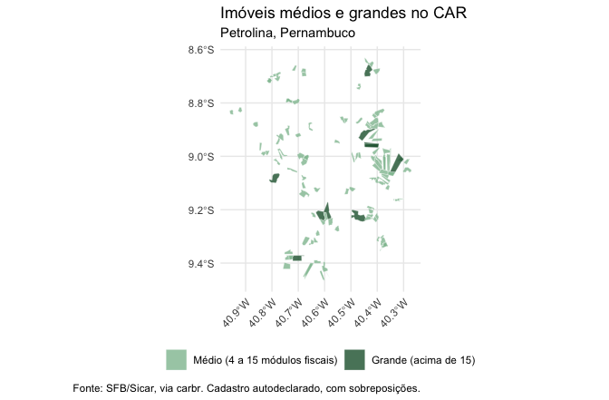

O **Cadastro Ambiental Rural (CAR)** é o registro público eletrônico dos
imóveis rurais do país, criado pelo Código Florestal (Lei nº 12.651/2012) e
mantido no Sicar pelo Serviço Florestal Brasileiro. O `carbr` lê uma
republicação dos dados públicos do cadastro em GeoParquet: cada consulta
transfere só os trechos do arquivo de que precisa, sem baixar a base de um
estado inteiro e sem passar pelos servidores do Sicar.

| Função | Para quê |
|---|---|
| `car_catalog()` | O que está publicado |
| `car_dictionary()` | O que cada coluna significa |
| `car_municipalities()` | Resumo por município |
| `car_properties()` | Imóveis de uma UF, com filtros |
| `car_property()` | Um imóvel pelo código |
| `car_at()` | Imóveis que contêm um ponto |
| `car_tbl()` | Tabela preguiçosa para o `dplyr` |
| `car_cite()` | Como citar |


``` r
library(carbr)
library(dplyr)
library(ggplot2)
```

## O que está publicado

`car_catalog()` traz uma linha por UF, com o número de imóveis e os
indicadores de qualidade da carga. A versão é a data em que os dados foram
lidos do Sicar.


``` r
cat <- car_catalog()
cat
#> # A tibble: 1 × 6
#>   state properties municipalities invalid_geometries null_geometries
#>   <chr>      <int>          <int>              <int>           <int>
#> 1 PE        436190            184                 50               0
#>   registered_in_other_state
#>                       <int>
#> 1                         7
attr(cat, "version")
#> [1] "2026-11-25"
```

O dicionário de dados diz o que é cada coluna e qual era o seu nome no Sicar.


``` r
car_dictionary() |> print(n = 22)
#> # A tibble: 22 × 3
#>    column             sicar_name        
#>    <chr>              <chr>             
#>  1 property_code      cod_imovel        
#>  2 status_code        status_imovel     
#>  3 status             <NA>              
#>  4 condition          condicao          
#>  5 property_type_code tipo_imovel       
#>  6 property_type      <NA>              
#>  7 created_at         dat_criacao       
#>  8 area_ha            area              
#>  9 fiscal_modules     m_fiscal          
#> 10 size_class         <NA>              
#> 11 state              uf                
#> 12 municipality       municipio         
#> 13 municipality_code  cod_municipio_ibge
#> 14 registration_state <NA>              
#> 15 lon                <NA>              
#> 16 lat                <NA>              
#> 17 geometry_valid     <NA>              
#> 18 xmin               <NA>              
#> 19 ymin               <NA>              
#> 20 xmax               <NA>              
#> 21 ymax               <NA>              
#> 22 geometry           geo_area_imovel   
#>    description                                                                  
#>    <chr>                                                                        
#>  1 Código do imóvel no CAR (UF-município IBGE-identificador).                   
#>  2 Situação do cadastro: AT ativo, PE pendente, SU suspenso, CA cancelado.      
#>  3 Situação do cadastro por extenso, derivada de status_code.                   
#>  4 Etapa da análise em que o cadastro está, como informada pelo Sicar.          
#>  5 IRU imóvel rural, AST assentamento, PCT povos e comunidades tradicionais.    
#>  6 Tipo do imóvel por extenso, derivado de property_type_code.                  
#>  7 Data e hora de criação do cadastro (UTC).                                    
#>  8 Área declarada do imóvel, em hectares.                                       
#>  9 Área em módulos fiscais do município.                                        
#> 10 small até 4 módulos fiscais, medium acima de 4 até 15, large acima de 15.    
#> 11 UF onde o imóvel está localizado.                                            
#> 12 Município onde o imóvel está localizado.                                     
#> 13 Código IBGE do município (7 dígitos).                                        
#> 14 UF do prefixo de property_code; pode diferir de state.                       
#> 15 Longitude de um ponto dentro do imóvel (SIRGAS 2000).                        
#> 16 Latitude de um ponto dentro do imóvel (SIRGAS 2000).                         
#> 17 Se a geometria declarada é válida (sem autointerseção etc.).                 
#> 18 Limite oeste do retângulo envolvente do imóvel, para filtro espacial na leit…
#> 19 Limite sul do retângulo envolvente.                                          
#> 20 Limite leste do retângulo envolvente.                                        
#> 21 Limite norte do retângulo envolvente.                                        
#> 22 Perímetro declarado do imóvel, WKB, EPSG:4674. Nulo se o Sicar não traz.
```

## Resumo por município

Para contagens, não é preciso ler os imóveis: o resumo municipal é um
arquivo pequeno, guardado em cache.


``` r
car_municipalities("PE") |>
  arrange(desc(properties)) |>
  select(municipality, properties, small_properties, area_ha, pending)
#> # A tibble: 184 × 5
#>   municipality properties small_properties area_ha pending
#>   <chr>             <int>            <int>   <dbl>   <int>
#> 1 Araripina         15663            15625 187423.       1
#> 2 Ouricuri          14200            14182 219157.       6
#> 3 Petrolina         10918            10799 411153.      11
#> 4 Buíque             9734             9651 109496.       3
#> 5 Bodocó             7271             7236 147941.       2
#> 6 Custódia           6598             6540 153166.       1
#> # ℹ 178 more rows
```

## Imóveis de um município

Os filtros de `car_properties()` são aplicados antes da leitura. Aqui, os
imóveis médios e grandes de Petrolina — algumas centenas, de um arquivo com
mais de 400 mil. Com o pacote `sf` instalado, o resultado é um objeto `sf`
em SIRGAS 2000.


``` r
petrolina <- car_properties(
  "PE",
  municipality = "Petrolina",
  size_class = c("medium", "large")
)
petrolina |> select(property_code, status, area_ha, fiscal_modules, size_class)
#> Simple feature collection with 119 features and 5 fields
#> Geometry type: MULTIPOLYGON
#> Dimension:     XY
#> Bounding box:  xmin: -40.96095 ymin: -9.465393 xmax: -40.26997 ymax: -8.629952
#> Geodetic CRS:  SIRGAS 2000
#> # A tibble: 119 × 6
#>   property_code                               status area_ha fiscal_modules
#>   <chr>                                       <chr>    <dbl>          <dbl>
#> 1 PE-2611101-111805B2DFBA4AF7B2BE2458D8CE27FD active    652.          11.6 
#> 2 PE-2611101-B095898582B2428EBDD3200C7CA25992 active    245.           4.46
#> 3 PE-2611101-69A386072C4E4D3189F24800452142C1 active    246.           4.47
#> 4 PE-2611101-C283CE3BF96A440DBE8D9026B91FC2C1 active    535.           9.73
#> 5 PE-2611101-ADEC18D9D8EA4CB6B5A3F56074EA0B63 active    432.           7.86
#> 6 PE-2611101-03F43B55FBE64453A6F2F740902D02CB active    804.          14.6 
#>   size_class                                                            geometry
#>   <chr>                                                       <MULTIPOLYGON [°]>
#> 1 medium     (((-40.75303 -9.397993, -40.75799 -9.422049, -40.73045 -9.4222, -4…
#> 2 medium     (((-40.61826 -9.430964, -40.61285 -9.428212, -40.59929 -9.464471, …
#> 3 medium     (((-40.60167 -9.465393, -40.59937 -9.464515, -40.60074 -9.461139, …
#> 4 medium     (((-40.59909 -9.395273, -40.59908 -9.395334, -40.59844 -9.395319, …
#> 5 medium     (((-40.67597 -9.459559, -40.64619 -9.406101, -40.65469 -9.401102, …
#> 6 medium     (((-40.68179 -9.449823, -40.67185 -9.431734, -40.65942 -9.409054, …
#> # ℹ 113 more rows
```


``` r
ggplot(petrolina) +
  geom_sf(aes(fill = size_class), colour = "white", linewidth = 0.1, alpha = 0.8) +
  scale_fill_manual(
    values = c(medium = "#8fbf9f", large = "#1f5f3a"),
    breaks = c("medium", "large"),
    labels = c(medium = "Médio (4 a 15 módulos fiscais)", large = "Grande (acima de 15)"),
    name = NULL
  ) +
  labs(
    title = "Imóveis médios e grandes no CAR",
    subtitle = "Petrolina, Pernambuco",
    caption = "Fonte: SFB/Sicar, via carbr. Cadastro autodeclarado, com sobreposições."
  ) +
  theme_minimal() +
  theme(legend.position = "bottom", axis.text.x = element_text(angle = 45, hjust = 1))
```

<div class="figure" style="text-align: center">

<p class="caption">plot of chunk petrolina</p>
</div>

O município pode ser dado pelo nome (sem diferenciar maiúsculas nem acentos)
ou pelo código IBGE de sete dígitos. Os outros filtros são `status`,
`property_type` e `bbox`.

## Sem a geometria

A geometria é a parte pesada do arquivo. Quando só os atributos interessam,
`geometry = FALSE` deixa de transferi-la. Os cadastros pendentes de
Pernambuco, por município:


``` r
pending <- car_properties("PE", status = "pending", geometry = FALSE)
pending |> count(municipality, sort = TRUE)
#> # A tibble: 100 × 2
#>   municipality             n
#>   <chr>                <int>
#> 1 Carnaubeira da Penha   145
#> 2 Floresta               104
#> 3 Águas Belas             59
#> 4 Pesqueira               35
#> 5 Jatobá                  28
#> 6 Tupanatinga             23
#> # ℹ 94 more rows
```

## Que imóveis estão declarados aqui?

`car_at()` devolve os imóveis que contêm um ponto. Como o cadastro é
autodeclarado, sobreposições são comuns e o resultado pode ter mais de uma
linha.


``` r
car_at(lon = -40.5, lat = -9.2) |>
  sf::st_drop_geometry() |>
  select(property_code, municipality, area_ha, status, condition)
#> # A tibble: 1 × 5
#>   property_code                               municipality area_ha status
#>   <chr>                                       <chr>          <dbl> <chr> 
#> 1 PE-2611101-588BC484570D440484F527F07DF5AFFA Petrolina     81579. active
#>   condition         
#>   <chr>             
#> 1 Aguardando análise
```

## Um imóvel pelo código


``` r
car_property("PE-2611101-588BC484570D440484F527F07DF5AFFA", geometry = FALSE) |>
  glimpse()
#> Rows: 1
#> Columns: 21
#> $ property_code      <chr> "PE-2611101-588BC484570D440484F527F07DF5AFFA"
#> $ status_code        <chr> "AT"
#> $ status             <chr> "active"
#> $ condition          <chr> "Aguardando análise"
#> $ property_type_code <chr> "AST"
#> $ property_type      <chr> "settlement"
#> $ created_at         <dttm> 2026-02-13 16:21:54
#> $ area_ha            <dbl> 81578.6
#> $ fiscal_modules     <dbl> 0.5209
#> $ size_class         <chr> "small"
#> $ state              <chr> "PE"
#> $ municipality       <chr> "Petrolina"
#> $ municipality_code  <int> 2611101
#> $ registration_state <chr> "PE"
#> $ lon                <dbl> -40.55024
#> $ lat                <dbl> -9.131521
#> $ geometry_valid     <lgl> TRUE
#> $ xmin               <dbl> -40.82484
#> $ ymin               <dbl> -9.398057
#> $ xmax               <dbl> -40.29828
#> $ ymax               <dbl> -8.864982
```

## Consultas próprias

`car_tbl()` devolve uma tabela preguiçosa do `dplyr` sobre os arquivos
publicados. Nada é lido até o `collect()`, e a agregação roda sobre o
arquivo remoto lendo só as colunas usadas.


``` r
car_tbl("PE") |>
  group_by(size_class) |>
  summarise(properties = n(), area_ha = sum(area_ha, na.rm = TRUE)) |>
  collect()
#> # A tibble: 3 × 3
#>   size_class properties  area_ha
#>   <chr>           <dbl>    <dbl>
#> 1 large            1373 1229005.
#> 2 medium           5167 1272210.
#> 3 small          429650 5934124.
```

## Como citar


``` r
car_cite()
#> Serviço Florestal Brasileiro. Sistema Nacional de Cadastro Ambiental Rural
#> (Sicar): imóveis rurais. Dados organizados pelo CastLab/UFPE (pacote carbr),
#> versão 2026-11-25.
```

## Endereço dos dados e cache

O pacote lê de um bucket público. Para usar um espelho compatível com S3 ou
uma cópia local da publicação, defina `options(carbr.base_url = )` ou a
variável de ambiente `CAR_URL`. O catálogo e o resumo municipal ficam em
cache em `car_cache_dir()`; os imóveis nunca são copiados para o disco.
