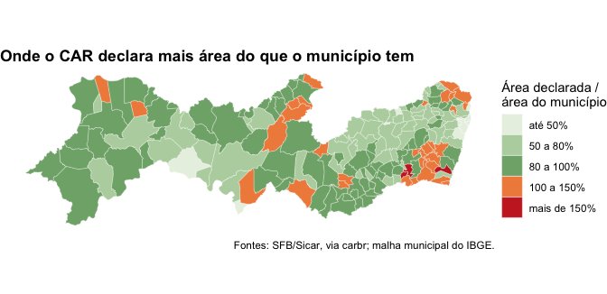
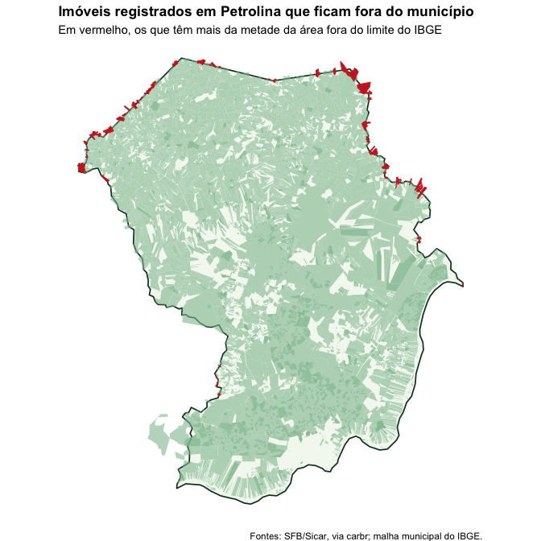

O CAR é **autodeclarado**: quem desenha o perímetro e informa os dados é o
próprio declarante, e a conferência vem depois, na análise. Enquanto ela não
chega, o cadastro guarda sobreposições, imóveis fora do município informado
e áreas que não fecham com o território. Este guia mostra como encontrar
essas inconsistências com o `carbr`, do país até um município.

Nada aqui é juízo sobre um imóvel em particular: são sinais para orientar a
análise e para quem usa os dados saber o que tem em mãos.


``` r
library(carbr)
library(dplyr)
library(ggplot2)
library(sf)

# Malhas do IBGE, direto da API de malhas, em SIRGAS 2000.
ibge_mesh <- function(path) {
  read_sf(paste0(
    "https://servicodados.ibge.gov.br/api/v3/malhas/", path,
    "formato=application/vnd.geo%2Bjson&qualidade=intermediaria"
  )) |>
    st_transform(4674)
}
```

## O que a carga já registra

Ao republicar os dados, o `carbr` anota no catálogo o que encontrou em cada
UF: geometrias inválidas (com autointerseção, por exemplo) e imóveis cujo
código começa com a sigla de outra UF.


``` r
cat <- car_catalog()
cat |>
  arrange(desc(invalid_geometries)) |>
  select(state, properties, invalid_geometries, registered_in_other_state)
#> # A tibble: 27 × 4
#>   state properties invalid_geometries registered_in_other_state
#>   <chr>      <int>              <int>                     <int>
#> 1 MG       1185013                597                         0
#> 2 SP        474172                498                         0
#> 3 GO        245524                210                         4
#> 4 PR        559480                185                         0
#> 5 MS         90552                156                         0
#> 6 SC        437300                134                         0
#> # ℹ 21 more rows
```


São 2748 geometrias inválidas no país, mantidas na publicação e
marcadas na coluna `geometry_valid`, e 29 imóveis com código de
outra UF.

## O código diz um município, o cadastro diz outro

O código do imóvel traz o município em que ele foi registrado
(`UF-0000000-…`). Em Pernambuco, comparando com a coluna `municipality_code`:


``` r
moved <- car_tbl("PE") |>
  mutate(code_municipality = substr(property_code, 4L, 10L)) |>
  filter(code_municipality != as.character(municipality_code)) |>
  select(property_code, municipality, area_ha) |>
  collect()

nrow(moved)
#> [1] 1138
moved |> count(municipality, sort = TRUE)
#> # A tibble: 163 × 2
#>   municipality     n
#>   <chr>        <int>
#> 1 Araripina      106
#> 2 Trindade       102
#> 3 Pedra           79
#> 4 Itaíba          47
#> 5 Itapetim        25
#> 6 Ouricuri        25
#> # ℹ 157 more rows
```

Nem todo caso é erro — imóveis mudam de município quando a base municipal é
atualizada —, mas é uma lista curta para conferir.

## Mais área declarada do que território

Somando a área declarada dos imóveis de cada município e dividindo pela área
do município na malha do IBGE, o resultado não deveria passar de 1. Passa em
vários.


``` r
mesh <- ibge_mesh("estados/PE?intrarregiao=municipio&")
mesh$territory_ha <- as.numeric(st_area(mesh)) / 1e4

ratio <- mesh |>
  transmute(municipality_code = as.integer(codarea), territory_ha) |>
  left_join(car_municipalities("PE"), by = "municipality_code") |>
  mutate(ratio = area_ha / territory_ha)

ratio |>
  st_drop_geometry() |>
  arrange(desc(ratio)) |>
  select(municipality, properties, area_ha, territory_ha, ratio)
#> # A tibble: 185 × 5
#>   municipality properties area_ha territory_ha ratio
#>   <chr>             <int>   <dbl>        <dbl> <dbl>
#> 1 Catende            1289  42584.       20837.  2.04
#> 2 Jaqueira           1203  16282.        8773.  1.86
#> 3 Rio Formoso         776  37162.       22932.  1.62
#> 4 Cortês              756  14887.       10327.  1.44
#> 5 Primavera           620  16195.       11245.  1.44
#> 6 Ribeirão            799  39829.       29218.  1.36
#> # ℹ 179 more rows
```


Em 35 dos 185 municípios de Pernambuco o cadastro soma
mais área do que o município tem; em Catende, o dobro. A
concentração na Zona da Mata sugere sobreposição sistemática entre
imóveis, não erro isolado.


``` r
ratio |>
  mutate(class = cut(
    ratio, c(0, 0.5, 0.8, 1, 1.5, Inf),
    labels = c("até 50%", "50 a 80%", "80 a 100%", "100 a 150%", "mais de 150%")
  )) |>
  ggplot() +
  geom_sf(aes(fill = class), colour = "white", linewidth = 0.1) +
  scale_fill_manual(
    values = c("#e8f1e4", "#b7d3ad", "#7fae78", "#f08c4a", "#c92a2a"),
    na.translate = FALSE, name = "Área declarada /\nárea do município"
  ) +
  coord_sf(xlim = c(-41.4, -34.8), ylim = c(-9.5, -7.25)) +
  labs(
    title = "Onde o CAR declara mais área do que o município tem",
    caption = "Fontes: SFB/Sicar, via carbr; malha municipal do IBGE."
  ) +
  theme_void() +
  theme(plot.title = element_text(face = "bold"))
```

<div class="figure" style="text-align: center">

<p class="caption">plot of chunk razao</p>
</div>

## Dentro de um município: Petrolina

Com os perímetros, dá para ir ao detalhe. Os imóveis não cancelados de
Petrolina e o limite do município:


``` r
petrolina <- car_properties("PE", municipality = "Petrolina") |>
  filter(status != "cancelled", geometry_valid)
boundary <- mesh |> filter(codarea == "2611101")
```

### Imóveis fora do município

Recortando cada imóvel pelo limite do município, em coordenadas planas para
medir em hectares, sai a parcela da área que fica do lado de fora. Faixas
estreitas na divisa são esperadas, porque o traçado do IBGE e o do
declarante nunca coincidem; o sinal é o imóvel com mais da metade da área
fora.


``` r
sf_use_s2(FALSE)
utm <- st_transform(petrolina, 31984)
inside <- st_intersection(select(utm, property_code), st_geometry(st_transform(boundary, 31984)))
inside_ha <- setNames(as.numeric(st_area(inside)) / 1e4, inside$property_code)

geometry_ha <- as.numeric(st_area(utm)) / 1e4
outside_share <- 1 - coalesce(inside_ha[utm$property_code], 0) / geometry_ha
petrolina$outside <- outside_share > 0.5

petrolina |>
  st_drop_geometry() |>
  summarise(properties = n(), outside_ha = sum(area_ha[outside]), outside = sum(outside))
#> # A tibble: 1 × 3
#>   properties outside_ha outside
#>        <int>      <dbl>   <int>
#> 1      10849      3359.      90
```


``` r
ggplot() +
  geom_sf(data = boundary, fill = "#f4f8f1", colour = "#123a23", linewidth = 0.6) +
  geom_sf(data = filter(petrolina, !outside), fill = "#8fbf9f", colour = NA, alpha = 0.6) +
  geom_sf(data = filter(petrolina, outside), fill = "#c92a2a", colour = "#c92a2a", linewidth = 0.3) +
  labs(
    title = "Imóveis registrados em Petrolina que ficam fora do município",
    subtitle = "Em vermelho, os que têm mais da metade da área fora do limite do IBGE",
    caption = "Fontes: SFB/Sicar, via carbr; malha municipal do IBGE."
  ) +
  theme_void() +
  theme(plot.title = element_text(face = "bold"))
```

<div class="figure" style="text-align: center">

<p class="caption">plot of chunk fora</p>
</div>

### Sobreposições

`st_overlaps()` aponta, para cada imóvel, os outros com que ele divide área
(tocar na divisa não conta):


``` r
overlaps <- lengths(st_overlaps(utm))

summed_ha <- sum(geometry_ha)
covered_ha <- as.numeric(st_area(st_union(utm))) / 1e4

tibble::tibble(
  properties = nrow(utm),
  overlapping = sum(overlaps > 0),
  summed_ha = round(summed_ha),
  covered_ha = round(covered_ha),
  double_counted_ha = round(summed_ha - covered_ha)
)
#> # A tibble: 1 × 5
#>   properties overlapping summed_ha covered_ha double_counted_ha
#>        <int>       <int>     <dbl>      <dbl>             <dbl>
#> 1      10849        8462    408603     367152             41451
```


78% dos imóveis sobrepõem ao menos um vizinho, quase sempre em faixas
estreitas na divisa. Somadas, as áreas passam em 41 mil hectares a
área de fato coberta. Os casos que mais pesam são poucos:


``` r
petrolina |>
  st_drop_geometry() |>
  mutate(neighbours = overlaps) |>
  arrange(desc(neighbours)) |>
  select(property_code, area_ha, fiscal_modules, size_class, neighbours)
#> # A tibble: 10,849 × 5
#>   property_code                               area_ha fiscal_modules size_class
#>   <chr>                                         <dbl>          <dbl> <chr>     
#> 1 PE-2611101-588BC484570D440484F527F07DF5AFFA  81579.          0.521 small     
#> 2 PE-2611101-5316F05D569C41C4847C52AF2C7E5CCB   6648.          0.623 small     
#> 3 PE-2611101-5149DB80F9E54FDDB445BDC40DF501AF    361.          6.56  medium    
#> 4 PE-2611101-0B75BD9F97224B73A761792FC4095A9C    306.          5.56  medium    
#> 5 PE-2611101-961DA0E4B2FA4FA6BA6601588C06310A    143.          2.54  small     
#> 6 PE-2611101-CB1BE273577643AD9BC07FB09008FB34    306.          5.56  medium    
#>   neighbours
#>        <int>
#> 1        325
#> 2         49
#> 3         41
#> 4         40
#> 5         26
#> 6         26
#> # ℹ 10,843 more rows
```

### "Pequeno" nem sempre é pequeno

O porte (`size_class`) vem dos módulos fiscais informados pelo Sicar, não da
área. Em assentamentos e territórios de povos e comunidades tradicionais, um
único cadastro cobre muitas famílias, e um perímetro de milhares de hectares
aparece com menos de quatro módulos. Em Pernambuco, os imóveis "pequenos"
com mais de 440 hectares — quatro vezes o maior módulo fiscal do país:


``` r
car_tbl("PE") |>
  filter(size_class == "small", area_ha > 440) |>
  group_by(property_type) |>
  summarise(properties = n(), area_ha = sum(area_ha, na.rm = TRUE)) |>
  collect()
#> # A tibble: 3 × 3
#>   property_type         properties area_ha
#>   <chr>                      <dbl>   <dbl>
#> 1 traditional_community         65 164138.
#> 2 rural_property                 1    926.
#> 3 settlement                   432 651693.
```

Quem conta "pequenos produtores" pelo porte deve separar o tipo do imóvel
(`property_type`) antes.

## O que fazer com isso

Cada sinal acima vira uma lista de imóveis: `property_code` leva ao cadastro,
e `car_property()` devolve o perímetro. Para repetir a análise em outro
município ou outra UF, basta trocar os argumentos.
